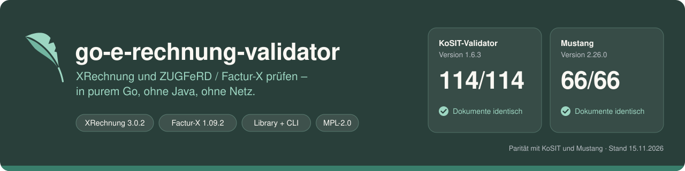
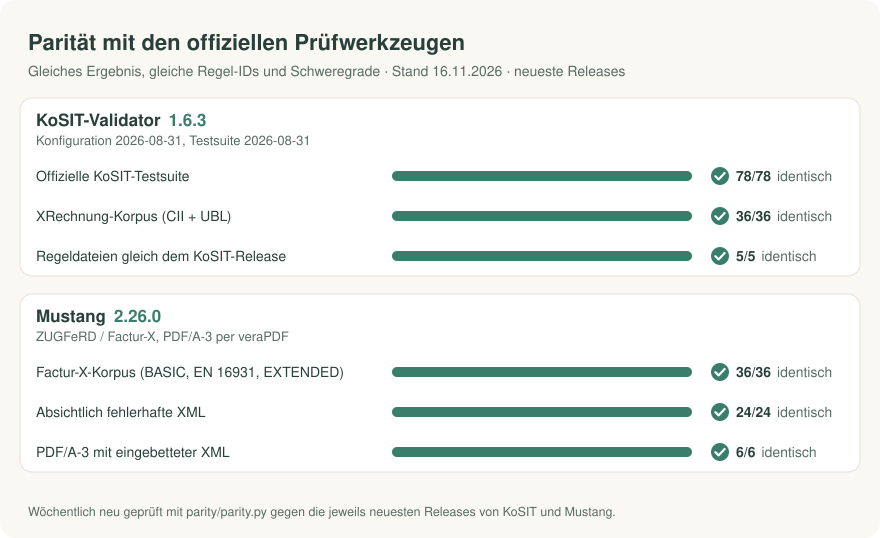

<p align="center">
  
</p>

<p align="center">
  <a href="https://github.com/papierleicht/go-e-rechnung-validator/actions/workflows/ci.yml"></a>
  <a href="https://github.com/papierleicht/go-e-rechnung-validator/actions/workflows/parity.yml"></a>
  <a href="#parität-mit-kosit-und-mustang"></a>
  <a href="#parität-mit-kosit-und-mustang"></a>
  <a href="https://pkg.go.dev/github.com/papierleicht/go-e-rechnung-validator"></a>
  <a href="LICENSE"></a>
</p>

# go-e-rechnung-validator

Prüft E-Rechnungen nach **XRechnung 3.0** (CII und UBL) und **ZUGFeRD / Factur-X**
(BASIC, EN 16931, EXTENDED) in purem Go – **ohne Java, ohne Netzwerk, ohne cgo**.
Eine Go-Library, ein Kommandozeilenwerkzeug und Testhelfer für eigene Rechnungsgeneratoren.

Geprüft wird mit den **offiziellen** XSD-Schemas und Schematron-Regeln: der
KoSIT-Konfiguration für XRechnung und dem FeRD-Paket für Factur-X. Sie sind im
Modul eingebettet und per SHA-256 festgeschrieben. Die Schweregrade folgen der
KoSIT-Szenariokonfiguration. Ein wöchentlicher Abgleich mit den jeweils neuesten
Releases des KoSIT-Validators und von Mustang zeigt: gleiches Ergebnis, gleiche
Regel-IDs, gleiche Schweregrade.

Die Library ist aus der Prüfung der Desktop-App
[E-Rechnung-Studio](https://github.com/papierleicht/E-Rechnung-Studio) entstanden.

## Installation

```sh
go get github.com/papierleicht/go-e-rechnung-validator
```

Go 1.25 oder neuer. Läuft überall, wo Go läuft (Linux, macOS, Windows, ARM).

## Rechnungen prüfen

```go
import validator "github.com/papierleicht/go-e-rechnung-validator"

v, err := validator.New(validator.Options{})
if err != nil {
	return err
}

result := v.Validate(xmlBytes) // XRechnung oder Factur-X als XML
// result := v.ValidatePDF(pdfBytes) // ZUGFeRD / Factur-X oder XRechnung als PDF

if !result.Accepted() {
	for _, issue := range result.Errors() {
		fmt.Println(issue.RuleID, issue.Message, issue.Location)
	}
}
```

| Feld | Inhalt |
| --- | --- |
| `State` | `valid`, `warning` (angenommen, mit Hinweisen), `invalid`, `unsupported`, `error` |
| `Format` | erkanntes Profil: `xrechnung-cii`, `xrechnung-ubl`, `facturx-basic`, `facturx-en16931`, `facturx-extended` |
| `Issues` | Funde mit `Stage` (`syntax`, `pdf`, `profile`, `xsd`, `rules`, `engine`), `RuleID` (z. B. `BR-DE-15`), `Severity`, `Message` und `Location` (XPath) |

Einen `Validator` einmal anlegen und wiederverwenden: Jedes Regelwerk wird beim
ersten Gebrauch kompiliert (rund eine Sekunde) und bleibt dann im Speicher. Eine
Prüfung dauert danach wenige Millisekunden. Der Validator ist sicher für
gleichzeitige Aufrufe.

Weitere Funktionen:

- `validator.Detect(xml)` erkennt das Profil anhand von Wurzelelement und
  Spezifikationskennung (BT-24), ohne zu prüfen.
- `validator.ExtractXML(pdf)` holt die eingebettete Rechnungs-XML aus einem
  ZUGFeRD-/Factur-X- oder XRechnung-PDF (EmbeddedFiles und `/AF`).
- `v.ValidateFile(path)` erkennt PDF oder XML am Inhalt.
- `validator.Rules()` nennt die Versionen und den SHA-256 des eingebetteten Regelwerks.

## In Go-Tests

Wer selbst E-Rechnungen erzeugt, prüft sie im Test gegen die offiziellen Regeln:

```go
import "github.com/papierleicht/go-e-rechnung-validator/validatortest"

func TestRechnungIstGueltig(t *testing.T) {
	xml := meinprogramm.Rechnung(beispiel)
	validatortest.AssertValid(t, xml)          // angenommen (auch mit Warnungen)
	validatortest.AssertNoWarnings(t, xml)     // ohne jeden Hinweis
}

func TestFalscheSummeWirdErkannt(t *testing.T) {
	validatortest.AssertInvalid(t, kaputteRechnung, "BR-CO-15")
}
```

Schlägt eine Prüfung fehl, listet der Test jeden Fund mit Regel-ID, Meldung und
XPath. Alle Assertions teilen sich einen Validator, die Regeln kompilieren also
nur einmal pro Testlauf. Für PDFs gibt es `AssertValidPDF`.

## Kommandozeile

```sh
go install github.com/papierleicht/go-e-rechnung-validator/cmd/e-rechnung-validate@latest

e-rechnung-validate rechnung.xml rechnung.pdf
e-rechnung-validate -q eingang/*.xml        # nur abgelehnte Dateien
e-rechnung-validate -json rechnung.xml      # maschinenlesbar
e-rechnung-validate -version                # Regelwerk und Hash
```

```text
✗ rechnung.xml: invalid (xrechnung-cii)
  fatal BR-CO-15 [rules] [BR-CO-15]-Invoice total amount with VAT (BT-112) = Invoice total amount without VAT (BT-109) + Invoice total VAT amount (BT-110). (/Q{…}CrossIndustryInvoice[1])
✓ rechnung.pdf: valid (facturx-en16931)
```

Exit-Status: `0` alle Dateien angenommen, `1` mindestens eine abgelehnt oder nicht
unterstützt, `2` Aufruffehler oder eine Prüfung, die nicht laufen konnte. Damit
eignet sich das Werkzeug direkt für CI-Pipelines.

## Parität mit KoSIT und Mustang

<p align="center">
  
</p>

Der Workflow [**Parity**](.github/workflows/parity.yml) lädt jede Woche die neuesten
Releases von KoSIT-Validator, XRechnung-Konfiguration, XRechnung-Testsuite und
Mustang (verifiziert per SHA-256) und vergleicht:

| Referenz | Geprüft | Gleich heißt |
| --- | --- | --- |
| KoSIT-Validator mit XRechnung-Konfiguration | offizielle KoSIT-Testsuite (Standard- und CIUS-Fälle) und der XRechnung-Korpus in [`testdata/corpus`](testdata/corpus) | gleiche Annahme oder Ablehnung, gleiche Regel-IDs mit gleichen Schweregraden |
| KoSIT-Konfiguration | `scenarios.xml` und Schematron-Dateien | byte-gleich mit dem neuesten Release, sonst schlägt der Abgleich als Drift fehl |
| Mustang (ZUGFeRD / Factur-X) | Factur-X-Korpus in allen drei Profilen und absichtlich beschädigte Kopien | gleiches Ergebnis, gleiche Regel-IDs |
| Mustang mit veraPDF | Factur-X-PDFs | Mustang hält PDF/A-3 und eingebettete XML für gültig, diese Library nimmt das PDF an |

Die Ergebnisse, die Grafiken oben und die Badges liegen im Branch
[`parity`](https://github.com/papierleicht/go-e-rechnung-validator/tree/parity)
(`results.json`). Bei einer Abweichung wird der Workflow rot und die Grafik zeigt
sie an. Lokal braucht der Abgleich Java 21+, Go und Netzwerk:

```sh
python3 parity/parity.py               # schreibt parity/results.json
go run ./internal/paritysvg -out out   # zeichnet parity.svg, banner.svg, Badges
```

Ohne Java und Netz hält `go test ./...` dieselben Ergebnisse fest: Für jedes
Dokument des Korpus steht das erwartete Ergebnis mit allen Regel-IDs in
[`testdata/corpus/expected.json`](testdata/corpus/expected.json).

## Was nicht geprüft wird

- **PDF/A-3-Konformität** des PDFs selbst. `ValidatePDF` prüft die eingebettete
  XML; für PDF/A braucht es veraPDF.
- **XRechnung-Extension** und **CVD**-Szenarien sowie die Factur-X-Profile
  **MINIMUM** und **BASIC WL**. Solche Dokumente ergeben `unsupported`.
- **Inhaltliche Richtigkeit** über die Regeln hinaus, etwa ob ein Steuersatz zum
  Geschäftsvorfall passt.

Die Parität belegt die geprüften Dokumente und Testfälle; sie ist keine
Zertifizierung. Die Meldungstexte stammen unverändert aus den Schematron-Regeln
und sind überwiegend englisch.

## Wie es funktioniert

- XSD 1.1, XPath 3.1 und XSLT 3.0 kommen aus [knroy/go-xml](https://github.com/knroy/go-xml),
  einer reinen Go-Implementierung. Die kompilierten Schematron-Stylesheets laufen
  darauf unverändert. Einzige Anpassung, nur im Speicher: Das Muster
  `match="root()"` der XRechnung-Stylesheets wird zu `match="/"`, was für
  vollständige Dokumente dasselbe bedeutet.
- Die Regeldateien liegen eingebettet im Modul ([`rules/`](rules), Hashes in
  [`rules.sha256.json`](rules.sha256.json)). `New` schreibt sie einmalig in ein
  Cache-Verzeichnis und prüft bei jedem Start die Hashes.
- XML mit `DOCTYPE` wird abgelehnt, externe Entitäten werden nie aufgelöst, die
  Stylesheets dürfen nur ihr eigenes Verzeichnis lesen. Eine Prüfung hat ein
  Zeitlimit (Standard 20 Sekunden).

## Regelwerk aktualisieren

1. Neue KoSIT-Konfiguration oder neues FeRD-Paket nach `rules/` übernehmen, ohne
   die Dateien zu verändern.
2. `rules.sha256.json` neu erzeugen, Versionen in `bundle.go` anpassen.
3. `go test -run TestCorpus -update` und die Änderungen an `expected.json` prüfen.
4. `python3 parity/parity.py` muss `PARITY` melden.

## Mitwirken

Issues und Pull Requests sind willkommen. Commit-Titel folgen
[Conventional Commits](https://www.conventionalcommits.org/). Bitte keine echten
Rechnungsdaten in Tests oder Issues. Jede Änderung an der Prüflogik muss die
Parität halten.

## Lizenz

Der Code steht unter der [Mozilla Public License 2.0](LICENSE). Die eingebetteten
Regeldateien behalten ihre eigenen Lizenzen; siehe [NOTICE.md](NOTICE.md) und
[`licenses/`](licenses).
